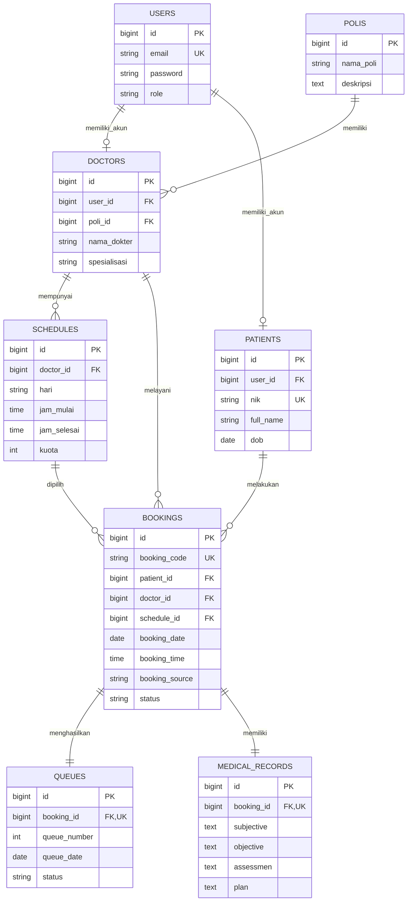

# Sistem Informasi Klinik Gabe Medika

<p align="center">
  
</p>

<p align="center">
  <strong>Solusi Digital Terintegrasi Layanan Kesehatan, Penjadwalan Dokter, Antrean Real-Time, dan Rekam Medis SOAP</strong><br>
  Proyek Mata Kuliah Pemrograman dan Pengujian Web (PPW)<br>
  <strong>Program Studi Sarjana Sistem Informasi — Fakultas Informatika dan Teknik Elektro<br>Institut Teknologi Del</strong><br>
  Tahun Ajaran 2026/2027
</p>

---

## 👥 Disusun Oleh (Kelompok)

| NIM | Nama Mahasiswa |
| :--- | :--- |
| **12S24035** | **Josua Sianturi** |
| **12S24014** | **Arion Manurung** |
| **12S24019** | **Winda N.V. Sitorus** |
| **12S24058** | **Airene Situmorang** |

---

## 📌 Daftar Isi
1. [Tentang Sistem](#-tentang-sistem)
2. [Latar Belakang & Masalah](#-latar-belakang--masalah)
3. [Deskripsi Aktor & Fitur Sistem (Use Case)](#-deskripsi-aktor--fitur-sistem-use-case)
4. [Alur Proses Bisnis (BPMN)](#-alur-proses-bisnis-bpmn)
5. [Arsitektur & Tumpukan Teknologi (Tech Stack)](#-arsitektur--tumpukan-teknologi-tech-stack)
6. [Perancangan Basis Data (ERD & Spesifikasi Tabel)](#-perancangan-basis-data-erd--spesifikasi-tabel)
7. [Struktur Direktori Proyek](#-struktur-direktori-proyek)
8. [Daftar Rute & Endpoint (Routing)](#-daftar-rute--endpoint-routing)
9. [Panduan Instalasi & Menjalankan Aplikasi](#-panduan-instalasi--menjalankan-aplikasi)
10. [Akun Demo & Quick Login](#-akun-demo--quick-login)
11. [Pengujian Perangkat Lunak (Testing)](#-pengujian-perangkat-lunak-testing)

---

## 🏥 Tentang Sistem

**Gabe Medika** adalah platform sistem informasi klinik berbasis web yang dirancang untuk mendigitalkan seluruh siklus layanan kesehatan primer. Sistem ini menjembatani interaksi antara **Pasien**, **Dokter**, **Resepsionis**, dan **Administrator Klinik** dalam satu ekosistem terpadu.

Aplikasi mengadopsi standar perancangan modern dengan tata letak desktop 3-zona (*Sidebar Navigasi*, *Area Konten Utama*, dan *Panel Sticky Booking*) serta antarmuka responsif adaptif untuk pengguna perangkat bergerak (*mobile bottom-sheet*).

---

## ❗ Latar Belakang & Masalah

Pada sistem layanan klinik konvensional (*current system*):
1. **Pendaftaran Manual:** Pasien harus datang langsung (*walk-in*) mengambil nomor antrean fisik atau mendaftar melalui pesan singkat, menyebabkan penumpukan fisik di ruang tunggu klinik.
2. **Penjadwalan Rentan Bentrok:** Jadwal praktik dokter dicatat secara manual di buku agenda, memicu bentrok waktu konsultasi dan ketidakjelasan kuota harian.
3. **Rekam Medis Fisik Berisiko:** Pencatatan riwayat kesehatan pasien menggunakan map kertas yang rawan tercecer, rusak, serta memperlambat proses temu kembali data historis saat pasien berkunjung kembali.

**Gabe Medika** mentransformasi proses tersebut menjadi **sistem terkomputerisasi daring (target system)**: reservasi slot waktu mandiri, nomor antrean otomatis dengan estimasi waktu kedatangan, serta pencatatan rekam medis elektronik berstandar **SOAP** (*Subjective, Objective, Assessment, Plan*).

---

## 🎯 Deskripsi Aktor & Fitur Sistem (Use Case)

Sistem Informasi Gabe Medika membagi interaksi pengguna ke dalam 4 aktor utama sesuai batasan Use Case sistem:

### 1. Pasien (Patient / User)
- **Registrasi & Autentikasi Akun:** Pembuatan akun mandiri dengan validasi identitas (NIK dan tanggal lahir).
- **Pencarian Dokter & Filter Spesialisasi:** Menemukan dokter berdasarkan nama, poli (Kardiologi, Neurologi, Ortopedi), rating, serta tarif konsultasi.
- **Reservasi / Booking Online:** Memilih tanggal dan slot jam praktik dokter secara interaktif dengan notifikasi toast konfirmasi.
- **Status Tiket Antrean:** Memantau nomor urut dan status kehadiran secara langsung.
- **Riwayat Medis Pasien:** Mengakses catatan hasil diagnosis dan resep terapi dari kunjungan terdahulu.

### 2. Resepsionis (Receptionist)
- **Monitoring Data Booking:** Memantau seluruh reservasi daring yang masuk secara harian.
- **Verifikasi Kedatangan (Check-in):** Mengonfirmasi kehadiran pasien saat tiba di loket klinik dan menerbitkan nomor antrean harian aktif.
- **Pendaftaran Pasien Langsung (Walk-in):** Memfasilitasi pasien yang datang tanpa reservasi daring langsung ke poli yang dituju.
- **Manajemen Alur Antrean:** Mengatur status pemanggilan pasien (*Waiting*, *Calling*, *Done*).

### 3. Dokter (Doctor)
- **Monitoring Antrean Poli Harian:** Memantau daftar pasien yang siap diperiksa di ruang praktiknya.
- **Akses Data Pasien:** Memeriksa identitas dasar, usia, dan riwayat keluhan pasien.
- **Input Rekam Medis SOAP:**
  - **S (Subjective):** Keluhan utama dan gejala yang dirasakan pasien.
  - **O (Objective):** Hasil pemeriksaan fisik, tanda-tanda vital (tensi, nadi, suhu), dan observasi klinis.
  - **A (Assessment):** Diagnosis medis dokter.
  - **P (Plan):** Rencana penanganan terapeutik, tindakan, dan peresepan obat.
- **Riwayat Rekam Medis:** Peninjauan riwayat medis longitudinal pasien dari pemeriksaan-pemeriksaan sebelumnya.

### 4. Administrator Klinik (Admin)
- **Master Data Poli:** Penambahan, pengubahan, dan pengarsipan bidang spesialisasi poli klinik.
- **Master Data Dokter:** Manajemen profil dokter, nomor izin praktik, serta asosiasi dengan poli terkait.
- **Pengelolaan Jadwal & Kuota Praktik:** Konfigurasi hari praktik, jam mulai, jam selesai, dan kuota maksimum per sesi.
- **Verifikasi Akun Pengguna:** Validasi dan aktivasi akun pasien serta staf klinik.
- **Dashboard Kalender Konsultasi:** Kalender interaktif pemantauan okupansi jadwal dan slot praktik dokter.

---

## 🔄 Alur Proses Bisnis (BPMN)

```
[ PASIEN ]           [ RESEPSIONIS / ADMIN ]           [ DOKTER ]
    |                           |                          |
    |-- 1. Pendaftaran Online ->|                          |
    |   (Pilih Dokter & Slot)   |                          |
    |                           |-- 2. Validasi & Kuota    |
    |<- 3. Kode Reservasi ------|                          |
    |                           |                          |
    |-- 4. Kedatangan/Check-in->|                          |
    |                           |-- 5. Terbitkan Antrean   |
    |                           |                          |
    |                           |------------------------->|-- 6. Panggil Pasien
    |                                                      |-- 7. Pemeriksaan Medis
    |                                                      |-- 8. Input SOAP & Resep
    |                                                      |
    |<- 9. Pembayaran Kasir & Penyerahan Obat -------------|
```

---

## 💻 Arsitektur & Tumpukan Teknologi (Tech Stack)

### Backend
- **Framework:** [Laravel 13](https://laravel.com/) (arsitektur Model-View-Controller)
- **Bahasa Pemrograman:** PHP 8.3 / PHP 8.5
- **ORM:** Eloquent ORM
- **Testing:** PHPUnit 12

### Frontend
- **Templating Engine:** Laravel Blade
- **CSS Framework:** [Tailwind CSS v4](https://tailwindcss.com/) dengan skema token kustom
- **Interaktivitas:** Vanilla JavaScript modern & React JSX Component (`DoctorRecommendations.jsx`)
- **Asset Bundler:** [Vite 8](https://vitejs.dev/)
- **Ikonografi & Desain:** SVG Sprites kustom, tipografi Plus Jakarta Sans & Inter, palet warna resmi **Deep Royal Navy** (`#012D68`)

### Basis Data
- **DBMS:** MySQL (Lingkungan Produksi / Staging) & SQLite (Lingkungan Pengembangan Lokal)
- **Struktur:** 8 tabel relasional ternormalisasi dengan integritas referensial penuh

---

## 🗄️ Perancangan Basis Data (ERD & Spesifikasi Tabel)

Basis data Gabe Medika dirancang berbasis relasi integritas tinggi (*referential integrity*):



### Kamus Data (Data Dictionary)

| Tabel | Kolom Utama | Tipe Data | Keterangan |
| :--- | :--- | :--- | :--- |
| `users` | `id`, `email`, `password`, `role` | BIGINT, VARCHAR, VARCHAR, VARCHAR | Otentikasi & kontrol peran (`admin`, `resepsionis`, `dokter`, `user`) |
| `polis` | `id`, `nama_poli`, `deskripsi` | BIGINT, VARCHAR, TEXT | Master spesialisasi poli klinik (Kardiologi, Neurologi, dsb.) |
| `doctors` | `id`, `user_id`, `poli_id`, `nama_dokter`, `spesialisasi` | BIGINT, BIGINT, BIGINT, VARCHAR, VARCHAR | Profil data dokter dan penempatan poli |
| `schedules` | `id`, `doctor_id`, `hari`, `jam_mulai`, `jam_selesai`, `kuota` | BIGINT, BIGINT, VARCHAR, TIME, TIME, INT | Slot jadwal jam kerja dan batas kuota harian |
| `patients` | `id`, `user_id`, `nik`, `full_name`, `dob` | BIGINT, BIGINT, VARCHAR, VARCHAR, DATE | Identitas kependudukan dan demografi pasien |
| `bookings` | `id`, `booking_code`, `patient_id`, `doctor_id`, `schedule_id`, `booking_date`, `status` | BIGINT, VARCHAR, BIGINT, BIGINT, BIGINT, DATE, VARCHAR | Transaksi pendaftaran online maupun walk-in |
| `queues` | `id`, `booking_id`, `queue_number`, `queue_date`, `status` | BIGINT, BIGINT, INT, DATE, VARCHAR | Tiket antrean harian (`waiting`, `calling`, `done`) |
| `medical_records` | `id`, `booking_id`, `subjective`, `objective`, `assessmen`, `plan` | BIGINT, BIGINT, TEXT, TEXT, TEXT, TEXT | Catatan rekam medis digital berstandar SOAP |

---

## 📁 Struktur Direktori Proyek

```plaintext
KLIDEL-JAYA/
├── app/
│   ├── Http/
│   │   ├── Controllers/
│   │   │   ├── AdminController.php     # Controller dashboard kalender admin
│   │   │   ├── AuthController.php      # Controller autentikasi & login
│   │   │   ├── Controller.php          # Base controller
│   │   │   └── HomeController.php      # Controller dashboard beranda pasien
│   │   └── Middleware/
│   │       └── AdminMiddleware.php     # Proteksi rute khusus administrator
│   ├── Models/
│   │   └── User.php                    # Model entitas pengguna & RBAC helper
│   └── Providers/
│       └── AppServiceProvider.php
├── bootstrap/
│   └── app.php                         # Inisialisasi aplikasi Laravel & middleware
├── config/                             # Konfigurasi aplikasi, database, auth, dsb.
├── database/
│   ├── factories/
│   ├── migrations/                     # Skema migrasi tabel basis data
│   └── seeders/
│       └── DatabaseSeeder.php          # Seeder data pengguna demo (Admin & Pasien)
├── public/
│   ├── images/
│   │   ├── 3d/                         # Aset visual 3D (mikroskop, stetoskop)
│   │   ├── doctors/                    # Foto profil dokter
│   │   ├── gabe-medica-logo.png        # Logo resmi Gabe Medika
│   │   └── login-hero.png              # Ilustrasi halaman login
│   └── index.php                       # Front controller aplikasi
├── resources/
│   ├── css/
│   │   └── app.css                     # Desain token, styling Tailwind v4 & tema
│   ├── js/
│   │   ├── components/
│   │   │   └── DoctorRecommendations.jsx # Komponen React kartu dokter 3D pop-out
│   │   └── app.js                      # Handler logika UI, filter, & booking panel
│   └── views/
│       ├── admin/
│       │   └── calendar.blade.php      # Tampilan kalender konsultasi multi-dokter
│       ├── auth/
│       │   └── login.blade.php         # Tampilan portal masuk (login split-screen)
│       ├── layouts/
│       │   └── app.blade.php           # Template layout induk responsif
│       └── home.blade.php              # Tampilan beranda & katalog booking pasien
├── routes/
│   ├── console.php
│   └── web.php                         # Definisi rute web aplikasi
├── tests/
│   └── Feature/
│       ├── AuthRoleTest.php            # Pengujian otentikasi & proteksi hak akses
│       └── HomeViewTest.php            # Pengujian rendering view beranda
├── composer.json                       # Konfigurasi dependensi PHP & skrip setup
├── package.json                        # Konfigurasi dependensi Node.js & Vite
└── README.md                           # Dokumentasi komprehensif proyek
```

---

## 🌐 Daftar Rute & Endpoint (Routing)

| Metode HTTP | Endpoint URI | Nama Rute | Controller & Method | Middleware | Deskripsi |
| :--- | :--- | :--- | :--- | :--- | :--- |
| `GET` | `/login` | `login` | `AuthController@showLoginForm` | `guest` | Menampilkan formulir masuk portal |
| `POST` | `/login` | `login.post` | `AuthController@login` | `guest` | Memproses otentikasi kredensial |
| `POST` | `/logout` | `logout` | `AuthController@logout` | `auth` | Mengakhiri sesi pengguna aktif |
| `GET` | `/quick-login/{role}` | `quick-login` | `AuthController@quickLogin` | - | Masuk instan untuk pengujian (`admin`/`user`) |
| `GET` | `/` | `home` | `HomeController@index` | - | Beranda pasien & direktori dokter |
| `GET` | `/calendar` | `calendar` | `HomeController@calendar` | - | Kalender jadwal konsultasi pasien |
| `GET` | `/admin` | `admin.dashboard` | `AdminController@index` | `auth`, `admin` | Portal kalender & operasional administrator |
| `GET` | `/admin/calendar` | `admin.calendar` | `AdminController@index` | `auth`, `admin` | Tampilan kalender jadwal dokter terpadu |

---

## 🚀 Panduan Instalasi & Menjalankan Aplikasi

Ikuti tahapan berikut untuk menjalankan proyek di lingkungan pengembangan lokal:

### 1. Prasyarat Sistem
- **PHP:** Versi `>= 8.3` (ekstensi `pdo`, `sqlite3` atau `pdo_mysql`, `mbstring`, `openssl` aktif)
- **Composer:** Versi `>= 2.0`
- **Node.js & NPM:** Node.js `>= 18.x` & NPM `>= 9.x`
- **Web Server & DBMS:** Laragon / XAMPP (MySQL atau SQLite lokal)

### 2. Kloning Repositori
```bash
git clone https://github.com/WindaSitorus/KLIDEL-JAYA.git
cd KLIDEL-JAYA
```

### 3. Konfigurasi Lingkungan (.env)
Salin berkas konfigurasi template:
```bash
cp .env.example .env
```

Sesuaikan koneksi basis data pada berkas `.env` (secara bawaan dikonfigurasi untuk SQLite):
```env
APP_NAME="Gabe Medica"
APP_ENV=local
APP_DEBUG=true
APP_URL=http://localhost:8000

DB_CONNECTION=sqlite
# Jika menggunakan MySQL di Laragon:
# DB_CONNECTION=mysql
# DB_HOST=127.0.0.1
# DB_PORT=3306
# DB_DATABASE=gabe_medica
# DB_USERNAME=root
# DB_PASSWORD=
```

### 4. Instalasi Dependensi Backend & Generate Key
```bash
composer install
php artisan key:generate
```

### 5. Migrasi & Seeding Basis Data
Jalankan migrasi untuk menyusun tabel serta memasukkan data awal pengguna demo:
```bash
# Jika menggunakan SQLite, pastikan berkas database/database.sqlite tersedia:
touch database/database.sqlite

php artisan migrate --seed
```

### 6. Instalasi Dependensi Frontend & Kompilasi Aset
```bash
npm install
npm run build
```
> *Untuk pengembangan aktif dengan Live-Reload/Hot Module Replacement (HMR):*
> ```bash
> npm run dev
> ```

### 7. Menjalankan Server Lokal
```bash
php artisan serve
```
Akses aplikasi melalui peramban web pada alamat: [http://localhost:8000](http://localhost:8000).

---

## 🔑 Akun Demo & Quick Login

Untuk mempermudah demonstrasi dan evaluasi aplikasi, tersedia akun siap pakai:

| Peran (Role) | Alamat Email | Kata Sandi | Pintasan Quick-Login |
| :--- | :--- | :--- | :--- |
| **Administrator** | `admin@aihealth.com` | `password` | [Akses Cepat Admin](http://localhost:8000/quick-login/admin) |
| **Pasien (User)** | `user@aihealth.com` | `password` | [Akses Cepat Pasien](http://localhost:8000/quick-login/user) |

---

## 🧪 Pengujian Perangkat Lunak (Testing)

Proyek ini dilengkapi dengan unit & feature testing berbasis **PHPUnit** untuk memastikan keandalan rute, keamanan autorisasi RBAC, serta integritas tampilan:

Jalankan seluruh rangkaian pengujian otomatis dengan perintah:
```bash
php artisan test
```
atau menggunakan binary PHPUnit langsung:
```bash
vendor/bin/phpunit
```

### Cakupan Pengujian:
- `test_login_page_renders_successfully`: Memastikan halaman login termuat dengan elemen-elemen penting.
- `test_user_login_redirects_to_home`: Memastikan login sebagai pasien mengarahkan ke dashboard utama pasien.
- `test_admin_login_redirects_to_admin_portal`: Memastikan login sebagai administrator dialihkan ke portal admin.
- `test_guest_is_redirected_from_admin_dashboard`: Memastikan pengguna anonim dicegah mengakses portal admin.
- `test_regular_user_cannot_access_admin_dashboard`: Memastikan akun pasien biasa tidak diizinkan masuk ke rute `/admin`.
- `test_admin_can_access_admin_calendar_dashboard`: Memverifikasi hak akses administrator pada dashboard kalender.
- `test_quick_login_for_user` & `test_quick_login_for_admin`: Memastikan fungsi quick-login bekerja sesuai peran.
- `test_home_page_renders_successfully`: Memverifikasi struktur data view dokter, janji temu, dan kategori terpasang sempurna.

---

<p align="center">
  Dibuat dengan dedikasi untuk kemajuan pelayanan kesehatan digital di Indonesia.<br>
  <strong>&copy; 2026/2027 Kelompok Sistem Informasi — Institut Teknologi Del</strong>
</p>
